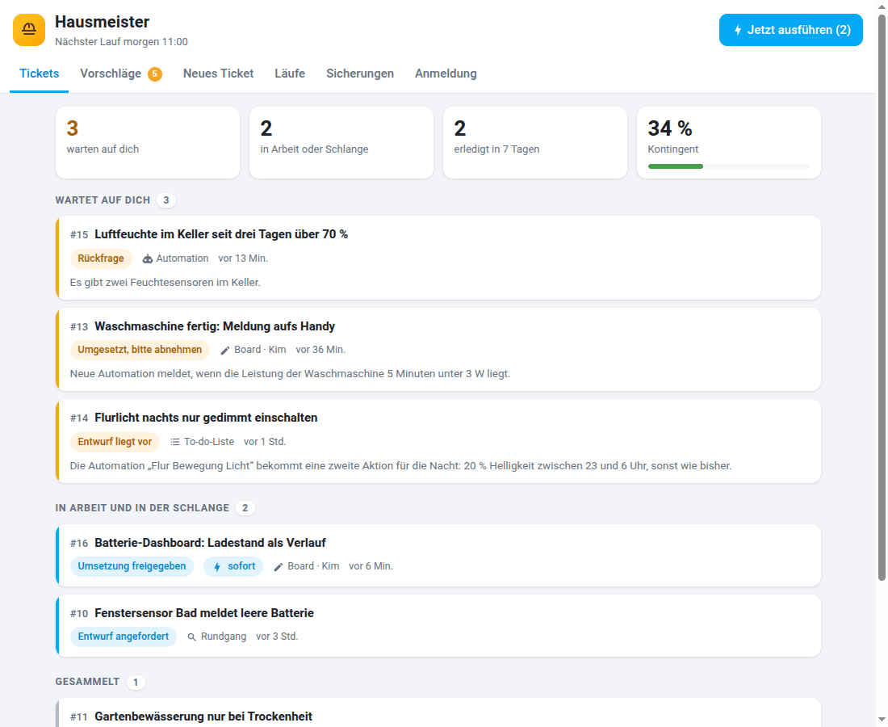
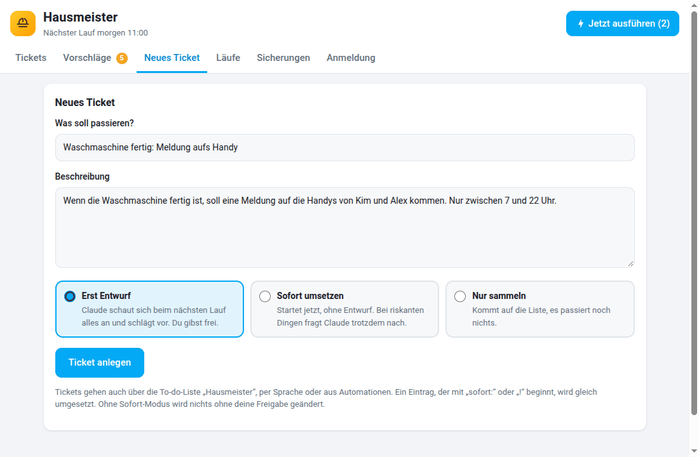
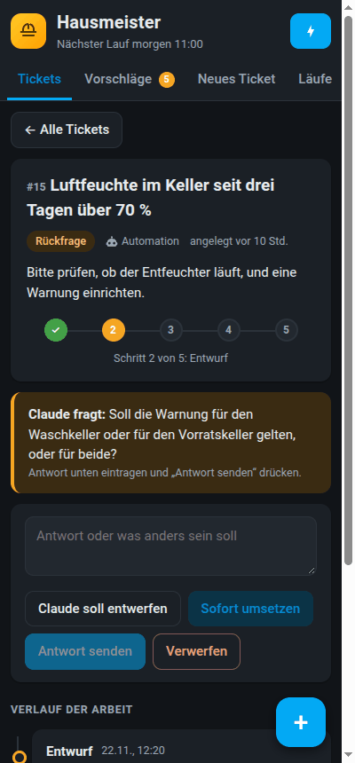

# Hausmeister

[English](README.md) | Deutsch

**Wünsche und Probleme im Smart Home aufschreiben, Claude Code kümmert sich darum, du gibst frei.**

Der Hausmeister ist ein Home-Assistant-Add-on mit einem kleinen Ticket-Board. Tickets kommen über eine
To-do-Liste (auch per Sprache), das Board oder eine Automation. Zu festen Zeiten schaut sich
[Claude Code](https://docs.claude.com/en/docs/claude-code/overview) die Installation an, schreibt einen
Entwurf und setzt ihn erst um, wenn du ihn freigibst. Vorher wird gesichert, danach prüfen Wächter,
ob etwas kaputtgegangen ist, und mit einem Knopf ist alles wieder zurückgerollt.

Alles läuft im Add-on auf deinem Home-Assistant-Rechner, auch die Anmeldung bei Claude. Es braucht
keinen weiteren Rechner.

Board, Meldungen und Claudes Texte gibt es auf Deutsch und Englisch. Die Sprache folgt Home Assistant oder wird mit der Option `language` festgelegt.



## Was es kann

- **Tickets von überall:** To-do-Liste „Hausmeister“ (auch per Assist), Board in der Seitenleiste, Ereignis
  `hausmeister_neues_ticket` aus Automationen.
- **Erst Entwurf, dann Umsetzung:** Im Entwurf darf Claude nur lesen. Geändert wird erst nach „Claude soll umsetzen“.
- **Sofort umsetzen**, wenn es schnell gehen soll: ohne Entwurfsfreigabe und ohne auf den Zeitplan zu warten.
  Bei riskanten Dingen fragt Claude trotzdem nach.
- **Sicherung vor jeder Änderung:** Schnappschuss der Konfiguration und eine HA-Teilsicherung ohne Datenbank.
- **Wächter:** Konfigurationsprüfung, geschrumpfte oder gelöschte Dateien, verschwundene oder nicht mehr
  verfügbare Entitäten, neue Fehler im Log. Auch zwischen den Läufen, wenn etwas anderes etwas kaputt macht.
- **Zurückrollen** mit einem Knopf.
- **Push-Meldungen mit Knöpfen:** freigeben, abnehmen, nachbessern oder eine Rückfrage beantworten, direkt
  aus der Benachrichtigung auf dem Handy.
- **Live-Fortschritt:** Du siehst, was Claude gerade tut.
- **Kontingentschutz:** Der Hausmeister liest die Auslastung deines Claude-Abos mit und pausiert geplante
  Läufe ab einer Grenze, damit für deine andere Arbeit genug übrig bleibt.
- **„Was würde ich anpassen?“:** Der Hausmeister schaut sich dein Haus an und schlägt vor, was sich lohnt, mit
  Begründung, Nutzen und Aufwand. Du übernimmst einen Vorschlag mit einem Klick als Ticket oder lehnst ihn ab.
  Auf Knopfdruck oder regelmäßig als Rundgang.
- **Doku je Ticket** als Markdown unter `/share/hausmeister/tickets/`, dazu eine Wissensdatei über dein Haus.

## So sieht es aus

**Vorschläge:** Was der Hausmeister an deinem Haus anpassen würde. Was ein Mensch vor Ort tun muss (Batterie,
Gerät), ist als „machst du selbst“ markiert.


| Entwurf zum Freigeben | Neues Ticket |
| --- | --- |
|  |  |

**Auf dem Handy** (hier im dunklen Modus): Übersicht mit Kennzahlen und eine Rückfrage von Claude. Die Antwort
geht über das Feld im Ticket oder direkt aus der Push-Meldung.

<p>

&nbsp;

</p>

Die Bilder zeigen erfundene Beispieltickets.

## Voraussetzungen

- Home Assistant OS oder Supervised (Add-ons), amd64 oder aarch64.
- Ein Claude-Abo (Pro oder Max) oder ein Anthropic-API-Schlüssel. Jeder Lauf verbraucht Kontingent.
  Steht nichts an, wird Claude gar nicht gestartet.

## Installation

1. In Home Assistant: **Einstellungen → Add-ons → Add-on-Store → ⋮ → Repositories**, diese Adresse eintragen:
   `https://github.com/andreashergert1984/homeassistant-addons`
2. **Hausmeister** installieren. Das Image wird auf deinem Rechner gebaut, das dauert ein paar Minuten.
3. Im Reiter **Info** „In der Seitenleiste anzeigen“ einschalten und das Add-on starten.
4. Optional: unter **Einstellungen → Geräte & Dienste → Integration hinzufügen → Lokale To-do-Liste** eine
   Liste namens **Hausmeister** anlegen (`todo.hausmeister`).

## Bei Claude anmelden

1. In der Seitenleiste **Hausmeister** öffnen, Reiter **Anmeldung**.
2. Im Terminal `claude` eingeben, dann `/login`.
3. „Claude account with subscription“ wählen, den Link im Browser öffnen, den Code zurück ins Terminal kopieren.
4. Mit `/exit` beenden. Oben im Board steht jetzt „Claude angemeldet“.

Die Anmeldung liegt im Add-on und ist aus den Home-Assistant-Sicherungen ausgenommen (die landen oft in der
Cloud). Nach dem Wiederherstellen einer Sicherung meldest du dich einmal neu an.

## Benutzen

**Ticket anlegen**, zum Beispiel auf die To-do-Liste „Hausmeister“: „Flurlicht nachts nur gedimmt einschalten“.
Beim nächsten Lauf schreibt Claude einen Entwurf, du bekommst eine Meldung.

**Entwurf lesen und entscheiden:**

| Knopf | Wirkung |
| --- | --- |
| Claude soll umsetzen | wird beim nächsten Lauf umgesetzt |
| Sofort umsetzen | wird jetzt umgesetzt |
| Claude soll entwerfen | neuer Entwurf, deinen Kommentar vorher ins Feld schreiben |
| Verwerfen | Ticket schließen |

**Nach der Umsetzung:** „Abnehmen, passt“, „Nachbessern“ mit Kommentar oder „Zurückrollen“.

**Sofort umsetzen von unterwegs:** einen Eintrag mit `sofort:`, `now:` oder `!` beginnen, zum Beispiel
„sofort: Weihnachtsbeleuchtung ab 17 Uhr einschalten“.

**Ticket aus einer Automation:**

```yaml
action: event.fire
data:
  event_type: hausmeister_neues_ticket
  event_data:
    titel: Luftfeuchte im Keller seit drei Tagen über 70 %
    text: Bitte prüfen, ob der Entfeuchter läuft, und eine Warnung einrichten.
    modus: entwurf   # entwurf, sofort oder sammeln
```

**Vorschläge holen:** Reiter **Vorschläge**, „Jetzt umschauen“. Oder mit `inspection_day` regelmäßig.
Pro Vorschlag: „Als Ticket“ (Entwurf), „Sofort umsetzen“, „Nur merken“ oder „Nicht nötig“. Abgelehnte Vorschläge
kommen nicht wieder.

**Sensoren für Dashboards:** `sensor.hausmeister_wartet_auf_dich` (Tickets, die dich brauchen) und
`sensor.hausmeister_offen` (alle offenen, mit nächstem Lauf, Kontingent und aktuellem Schritt).

## Einstellungen

| Option | Vorgabe | Bedeutung |
| --- | --- | --- |
| `run_times` | 11:00, 16:00 | Zeiten der Läufe |
| `auto_draft` | an | neue Tickets gleich entwerfen |
| `max_tickets_per_run` | 5 | höchstens so viele Tickets je Lauf |
| `run_timeout_minutes` | 30 | Zeitgrenze je Ticket |
| `backup_before_change` | an | HA-Teilsicherung vor jeder Umsetzung |
| `intake_todo` | todo.hausmeister | To-do-Liste für neue Tickets, leer schaltet aus |
| `notify_service` | | Push-Dienst, z. B. `notify.mobile_app_mein_handy` |
| `model` | | z. B. `sonnet` oder `opus`, leer = Vorgabe von Claude Code |
| `max_quota_percent` | 80 | geplante Läufe pausieren über dieser Abo-Auslastung, 0 = aus |
| `max_backup_gb` | 2 | keine HA-Sicherung vor einer Änderung, wenn der Konfigurationsordner größer ist; die Git-Sicherung läuft trotzdem |
| `inspection_day` | off | Rundgang: `off`, `daily` oder `mon` … `sun` (die deutschen Werte `aus`, `taeglich`, `mo` … `so` gelten weiter) |
| `language` | auto | Sprache: `auto` folgt Home Assistant (Deutsch oder Englisch, sonst Englisch), `de` oder `en` legt sie fest |

## Sicherheit, ehrlich gesagt

- Claude bekommt feste Regeln: keine Datei komplett neu schreiben, `.storage` nur über die API ändern,
  keine Geräte schalten, keine Add-ons, Updates, Benutzer oder Geheimnisse anfassen, vor jedem Neustart die
  Konfiguration prüfen. Im Entwurf sind Schreibwerkzeuge technisch gesperrt.
- In der Umsetzung hat das Add-on Schreibzugriff auf die Konfiguration und die Supervisor-Rolle `manager`.
  Die Regeln sind eine starke Vorgabe für das Modell, aber keine Sandbox. **Gib nur Entwürfe frei, die du
  verstehst.** Für „Sofort umsetzen“ gilt das erst recht.
- Board und Terminal sind nur für Home-Assistant-Admins sichtbar.
- Sicherungen: eigener Git-Verlauf der Konfiguration (ohne Datenbanken, Logs, Anmeldedaten, Modellordner und
  Dateien über 20 MB) und, wenn eingeschaltet, eine HA-Teilsicherung vor jeder Umsetzung.

Ausführliche Doku: [DOCS.md, Abschnitt Deutsch](DOCS.md#deutsch). Änderungen: [CHANGELOG.md](CHANGELOG.md).
