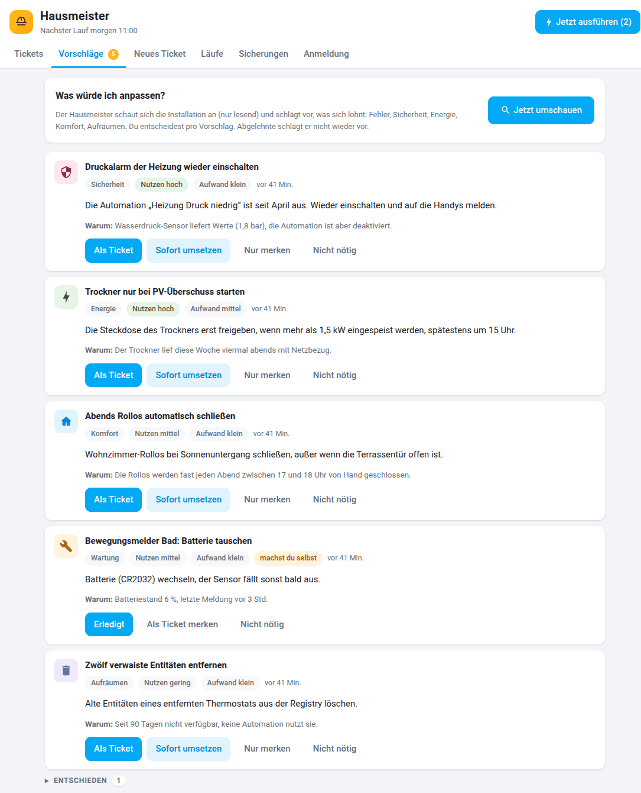
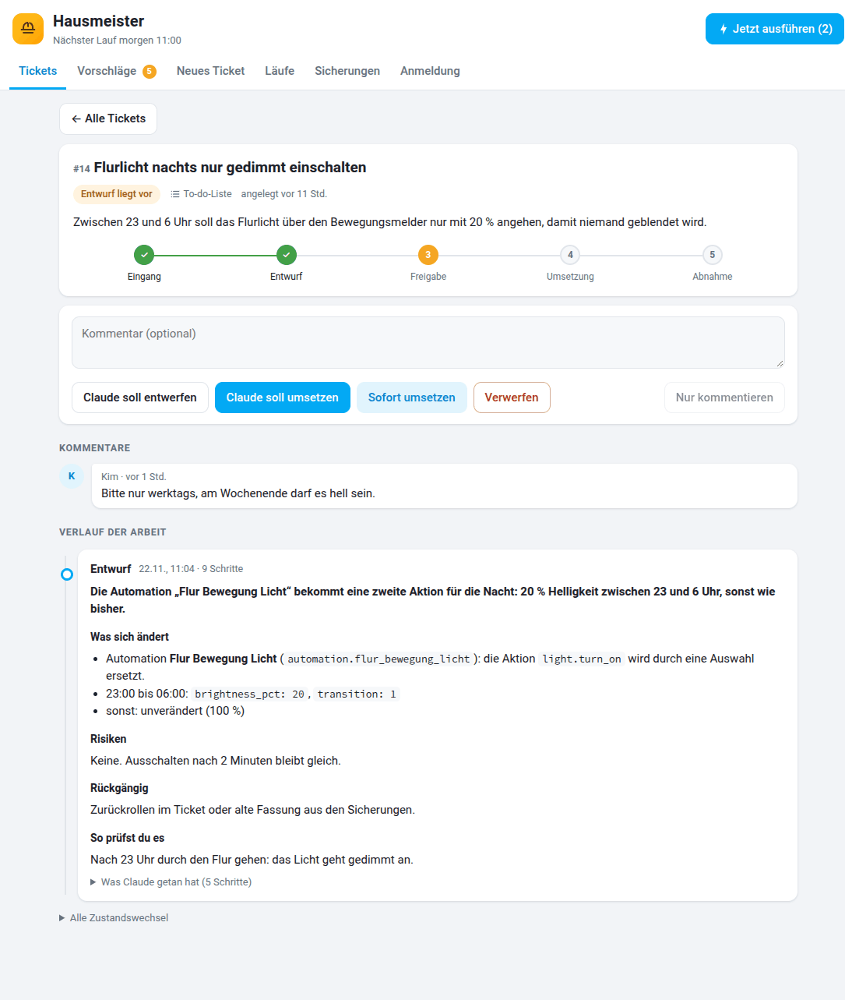
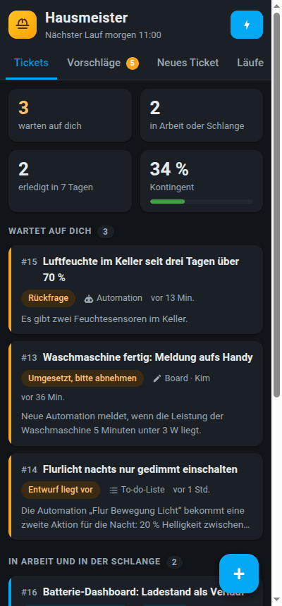

# Hausmeister

[English](README.md) | Deutsch

**Wünsche und Probleme im Smart Home aufschreiben, Claude Code kümmert sich darum, du gibst frei.**

Der Hausmeister ist ein Home-Assistant-Add-on mit einem kleinen Ticket-Board. Tickets kommen über eine
To-do-Liste (auch per Sprache), das Board oder eine Automation. Zu festen Zeiten schaut sich
[Claude Code](https://docs.claude.com/en/docs/claude-code/overview) die Installation an, schreibt einen
Entwurf und setzt ihn erst um, wenn du ihn freigibst. Vorher wird gesichert, danach prüfen Wächter,
ob etwas kaputtgegangen ist, und mit einem Knopf sind die geänderten Dateien wieder zurückgesetzt.

Alles läuft im Add-on auf deinem Home-Assistant-Rechner, auch die Anmeldung bei Claude. Es braucht
keinen weiteren Rechner.

Board, Meldungen und Claudes Texte gibt es auf Deutsch und Englisch. Die Sprache folgt Home Assistant oder wird mit der Option `language` festgelegt.


## Was es kann

- **Tickets von überall:** To-do-Liste „Hausmeister“ (auch per Assist), Board in der Seitenleiste, Ereignis
  `hausmeister_neues_ticket` aus Automationen.
- **Erst Entwurf, dann Umsetzung:** Im Entwurf darf Claude nur lesen. Geändert wird erst nach „Claude soll umsetzen“.
- **Sofort umsetzen**, wenn es schnell gehen soll: ohne Entwurfsfreigabe und ohne auf den Zeitplan zu warten.
  Bei riskanten Dingen fragt Claude trotzdem nach.
- **Sicherung vor jeder Änderung:** Git-Schnappschuss der Konfiguration und, wenn eingeschaltet, eine
  HA-Teilsicherung ohne Datenbank.
- **Wächter:** Konfigurationsprüfung, geschrumpfte oder gelöschte Dateien, verschwundene oder nicht mehr
  verfügbare Entitäten, neue Fehler im Log. Auch zwischen den Läufen, wenn etwas anderes etwas kaputt macht.
- **Zurückrollen** der Dateien einer Umsetzung mit einem Knopf.
- **Push-Meldungen mit Knöpfen:** freigeben, abnehmen, nachbessern oder eine Rückfrage beantworten, direkt
  aus der Benachrichtigung auf dem Handy.
- **Live-Fortschritt:** Du siehst, was Claude gerade tut.
- **Kontingentschutz:** Der Hausmeister liest die Auslastung deines Claude-Abos mit und pausiert geplante
  Läufe (und Sofort-Tickets von außerhalb des Boards) ab einer Grenze, damit für deine andere Arbeit genug übrig bleibt.
- **„Was würde ich anpassen?“:** Der Hausmeister schaut sich dein Haus an und schlägt vor, was sich lohnt, mit
  Begründung, Nutzen und Aufwand. Du übernimmst einen Vorschlag mit einem Klick als Ticket oder lehnst ihn ab.
  Auf Knopfdruck oder regelmäßig als Rundgang.
- **Doku je Ticket** als Markdown unter `/share/hausmeister/tickets/`, dazu eine Wissensdatei über dein Haus.

## So sieht es aus

**Vorschläge:** Was der Hausmeister an deinem Haus anpassen würde. Was ein Mensch vor Ort tun muss (Batterie,
Gerät), ist als „machst du selbst“ markiert.



| Entwurf zum Freigeben | Neues Ticket |
| --- | --- |
|  |  |

**Auf dem Handy** (hier im dunklen Modus): Übersicht mit Kennzahlen und eine Rückfrage von Claude. Die Antwort
geht über das Feld im Ticket oder direkt aus der Push-Meldung.

<p>

&nbsp;

</p>

Die Bilder zeigen erfundene Beispieltickets.

## Voraussetzungen

- Home Assistant OS oder Supervised (Add-ons), amd64 oder aarch64.
- Ein Claude-Abo (Pro oder Max) oder ein Anthropic-Console-Konto (Abrechnung über die API, ebenfalls bei
  `/login` wählbar). Jeder Lauf verbraucht Kontingent.
  Steht nichts an, wird Claude gar nicht gestartet.

## Installation

1. In Home Assistant: **Einstellungen → Add-ons → Add-on-Store → ⋮ → Repositories**, diese Adresse eintragen:
   `https://github.com/andreashergert1984/homeassistant-addons`
2. **Hausmeister** installieren. Das Image wird auf deinem Rechner gebaut, das dauert ein paar Minuten.
3. Im Reiter **Info** „In der Seitenleiste anzeigen“ einschalten und das Add-on starten.
4. Optional: unter **Einstellungen → Geräte & Dienste → Integration hinzufügen → Lokale To-do-Liste** eine
   Liste namens **Hausmeister** anlegen (`todo.hausmeister`).

## Bei Claude anmelden

1. In der Seitenleiste **Hausmeister** öffnen, Reiter **Anmeldung**.
2. Im Terminal `claude` eingeben, dann `/login`.
3. „Claude account with subscription“ wählen, den Link im Browser öffnen, den Code zurück ins Terminal kopieren.
4. Mit `/exit` beenden. Oben im Board steht jetzt „Claude angemeldet“.

Die Anmeldung liegt im Add-on und ist aus den Home-Assistant-Sicherungen ausgenommen (die landen oft in der
Cloud). Nach dem Wiederherstellen einer Sicherung meldest du dich einmal neu an.

## Benutzen

**Ticket anlegen**, zum Beispiel auf die To-do-Liste „Hausmeister“: „Flurlicht nachts nur gedimmt einschalten“.
Beim nächsten Lauf schreibt Claude einen Entwurf, du bekommst eine Meldung.

**Entwurf lesen und entscheiden:**

| Knopf | Wirkung |
| --- | --- |
| Claude soll umsetzen | wird beim nächsten Lauf umgesetzt |
| Sofort umsetzen | wird jetzt umgesetzt |
| Claude soll entwerfen | neuer Entwurf, deinen Kommentar vorher ins Feld schreiben |
| Verwerfen | Ticket schließen |

**Nach der Umsetzung:** „Abnehmen, passt“, „Nachbessern“ mit Kommentar oder „Zurückrollen“.

**Sofort umsetzen von unterwegs:** einen Eintrag mit `sofort:`, `now:` oder `!` beginnen, zum Beispiel
„sofort: Weihnachtsbeleuchtung ab 17 Uhr einschalten“ (braucht die Option `allow_immediate_from_outside`,
sonst bekommt der Eintrag zuerst einen Entwurf).

**Ticket aus einer Automation:**

```yaml
action: event.fire
data:
  event_type: hausmeister_neues_ticket
  event_data:
    titel: Luftfeuchte im Keller seit drei Tagen über 70 %
    text: Bitte prüfen, ob der Entfeuchter läuft, und eine Warnung einrichten.
    modus: entwurf   # entwurf, sofort oder sammeln
```

**Vorschläge holen:** Reiter **Vorschläge**, „Jetzt umschauen“. Oder mit `inspection_day` regelmäßig.
Pro Vorschlag: „Als Ticket“ (Entwurf), „Sofort umsetzen“, „Nur merken“ oder „Nicht nötig“; bei Dingen, die du
selbst machst, „Erledigt“, „Als Ticket merken“ oder „Nicht nötig“. Abgelehnte Vorschläge kommen nicht wieder
(„Zurückholen“ holt einen zurück).

**Sensoren für Dashboards:** `sensor.hausmeister_wartet_auf_dich` (Tickets, die dich brauchen) und
`sensor.hausmeister_offen` (alle offenen, mit nächstem Lauf, Kontingent und aktuellem Schritt).

## Einstellungen

| Option | Vorgabe | Bedeutung |
| --- | --- | --- |
| `run_times` | 11:00, 16:00 | Zeiten der Läufe |
| `auto_draft` | an | neue Tickets aus der To-do-Liste und Ereignisse ohne `modus` gleich entwerfen; aus = nur sammeln |
| `max_tickets_per_run` | 5 | höchstens so viele Tickets je Lauf |
| `run_timeout_minutes` | 30 | Zeitgrenze je Ticket |
| `backup_before_change` | an | HA-Teilsicherung vor jeder Umsetzung |
| `intake_todo` | todo.hausmeister | To-do-Liste für neue Tickets, leer schaltet aus |
| `notify_service` | | Push-Dienst, z. B. `notify.mobile_app_mein_handy` |
| `model` | | z. B. `sonnet` oder `opus`, leer = Vorgabe von Claude Code |
| `max_quota_percent` | 80 | geplante Läufe und Sofort-Tickets von außerhalb des Boards pausieren über dieser Abo-Auslastung, 0 = aus |
| `max_backup_gb` | 2 | keine HA-Sicherung vor einer Änderung, wenn der Konfigurationsordner größer ist; die Git-Sicherung läuft trotzdem |
| `inspection_day` | off | Rundgang: `off`, `daily` oder `mon` … `sun` (die deutschen Werte `aus`, `taeglich`, `mo` … `so` gelten weiter) |
| `language` | auto | Sprache: `auto` folgt Home Assistant (Deutsch oder Englisch, sonst Englisch), `de` oder `en` legt sie fest |
| `allow_immediate_from_outside` | aus | `sofort:`/`now:`/`!` in der To-do-Liste und `modus: sofort` im Ereignis setzen sofort um; aus = erst ein Entwurf; Board und Knöpfe in Meldungen sind nicht betroffen |

## Sicherheit, ehrlich gesagt

Was das Add-on zum Schutz deiner Installation tut:

- **Nur über Home Assistant:** Board, API und Terminal antworten nur dem Ingress-Gateway des Supervisors
  (Prüfung der IP-Adresse) und Loopback; andere Add-ons im internen Netz bekommen 403. Das Panel gibt es
  nur für Home-Assistant-Admins.
- **Entwürfe und Rundgänge als eigener Benutzer:** Sie laufen als Benutzer `hausmeister` (uid 1001),
  nicht als root. Dieser Benutzer kann die Konfiguration nicht schreiben und die Add-on-Optionen, den
  Ticketzustand und das Sicherungs-Repository nicht lesen. Seine Shell ist eingeschränkt auf `ha-read`,
  `cfg-git`, `echo`, `printf` und `date`; `ha-read` und `cfg-git` laufen über einen lokalen Proxy im
  Add-on, und `ha-read` liest nur (GET-Anfragen, eine feste Liste von WebSocket-Befehlen, Vorlagen, die
  Konfigurationsprüfung, das Core-Log). Dateien liest Claude nur mit den Werkzeugen Read, Grep und Glob;
  die Schreibwerkzeuge sind gesperrt.
- **Sperrregeln in jeder Phase:** `secrets.yaml` (in jedem Ordner), `.storage/auth*`,
  `.storage/core.config_entries` und `.storage/*credential*` (zum Beispiel `application_credentials`),
  die Anmeldung von Claude, das Sicherungs-Repository, `/proc` und der Code des Add-ons sind zum Lesen
  und Bearbeiten gesperrt; `curl`, `wget` und `nc` sind in der Shell gesperrt. `cfg-git` prüft jedes
  Argument (keine Optionen, die Dateien schreiben oder Programme starten), lässt diese Dateien in jedem
  Diff, Log und jeder Liste aus und lehnt sie ab, wenn sie genannt werden.
- **Kein Supervisor-Token für Claude:** Weder Claude noch das Terminal bekommen es. Jeder Claude-Aufruf
  bekommt ein eigenes Token für den Proxy: im Entwurf und Rundgang nur lesend; in der Umsetzung auch
  schreibend, aber nie an die Supervisor-API, die Dienste `hassio.*`, `shell_command.*` und
  `homeassistant.stop`, Benutzer und Anmeldungen, Anmeldedaten von Integrationen, `execute_script` oder
  die Ereignisse des Add-ons.
- **Internet:** Websuche, und WebFetch nur für home-assistant.io, community.home-assistant.io,
  github.com und raw.githubusercontent.com.
- **Von außerhalb des Boards** (To-do-Liste, Ereignis `hausmeister_neues_ticket`, Knöpfe in Meldungen):
  Es zählen nur aktive Admins, Ereignisse des eigenen Benutzers des Add-ons werden ignoriert. Jede
  Meldung trägt einen zufälligen Einmal-Code; ein Knopf wirkt einmal und nur an der neuesten Meldung
  eines Tickets. Höchstens 10 neue Tickets je Stunde. Sofort-Umsetzung aus der To-do-Liste oder per
  Ereignis nur mit der Option `allow_immediate_from_outside`, sonst bekommt das Ticket zuerst einen
  Entwurf.
- **Kontingentgrenze:** Über `max_quota_percent` warten geplante Läufe und Sofort-Tickets von außerhalb
  des Boards, bis das Fenster erneuert ist.
- **Sicherung, Wächter, Zurückrollen:** Vor jeder Umsetzung ein Git-Schnappschuss der Konfiguration (in
  `/data/configgit`, nur root liest ihn, nicht in HA-Sicherungen) und, wenn eingeschaltet und der Ordner
  nicht größer als `max_backup_gb` ist, eine HA-Teilsicherung ohne Datenbank. Danach prüfen die Wächter
  Konfiguration, geschrumpfte oder gelöschte Dateien und verschwundene oder nicht mehr verfügbare
  Entitäten; „Zurückrollen“ setzt die geänderten Dateien zurück.
- **Dateirechte:** Das Add-on ändert keine Rechte im Konfigurationsordner von Home Assistant. (Einzige
  Ausnahme war eine einmalige Reparatur in 0.8.2, die `secrets.yaml` wieder auf 0644 gesetzt hat,
  nachdem 0.8.1 sie auf 0600 gestellt hatte.)

Was bleibt:

- **Die Umsetzung nach deiner Freigabe läuft als root mit voller Shell.** Das muss sie, um
  `configuration.yaml` und die anderen Dateien zu ändern. Technisch kommt sie damit an alles im
  Container, auch an das Supervisor-Token (zum Beispiel über die Umgebung des Add-on-Prozesses, mit der
  Rolle `manager`) und ans Netzwerk (zum Beispiel mit `python3` oder `node` statt `curl`). Schutz bieten
  dort deine Freigabe des Entwurfs, die Regeln für Claude und danach Wächter und Zurückrollen. **Gib nur
  Entwürfe frei, die du verstehst.** „Sofort umsetzen“ überspringt diese Freigabe, also nur für kleine,
  klare Aufgaben nutzen.
- **Prompt-Injection:** Claude liest Texte aus deiner Installation (Entitätsnamen, Attribute, Dateien,
  Logzeilen, die Wissensdatei, Kommentare). So ein Text kann Anweisungen enthalten, die Claude lenken.
  Ein Entwurf kann nichts ändern, aber etwas Schädliches vorschlagen. Lies Entwürfe, bevor du sie
  freigibst.
- **Die Sperrregeln hängen an Claude Code.** Home Assistant schreibt `secrets.yaml` und
  `.storage/core.config_entries` für alle lokalen Benutzer lesbar (0644), der Entwurfsbenutzer könnte sie
  auf Dateiebene also lesen; Entwürfe hält die Rechteprüfung von Claude Code zusammen mit der
  eingeschränkten Shell davon fern.
- **Das Terminal** im Board ist eine root-Shell für Admins. Es hat kein Supervisor-Token, käme als root
  aber genauso daran wie eine Umsetzung.
- **Die Schnappschüsse enthalten `secrets.yaml`** und die Anmeldedaten von Integrationen, weil das
  Zurückrollen sie braucht. Sie bleiben in `/data/configgit`, das aus HA-Sicherungen ausgenommen ist.

## Update von einer Version vor 0.8

- Knöpfe in Meldungen von vor 0.8.0 wirken nicht mehr (sie tragen keinen Einmal-Code). Nutze das Board
  oder die Knöpfe der nächsten Meldung.
- To-do-Einträge, die mit `sofort:`, `now:` oder `!` beginnen, und `modus: sofort` in Ereignissen ergeben
  jetzt einen Entwurf, außer du schaltest die Option `allow_immediate_from_outside` ein.
- Das Ereignis `hausmeister_neues_ticket` zählt nur mit dem Benutzer eines aktiven Admins. Automationen,
  die ein Sensor auslöst, laufen ohne Benutzer; lass sie stattdessen einen Eintrag in die To-do-Liste
  schreiben (`todo.add_item` auf `todo.hausmeister`).
- Die Wissensdatei ist jetzt `/data/wissen.md` im Add-on (im Terminal des Boards bearbeiten). Eine
  vorhandene `/share/hausmeister/WISSEN.md` wird einmal übernommen; danach ist die Datei in `/share` nur
  noch ein Export, der beim Start und nach jedem Lauf überschrieben wird.

Ausführliche Doku: [DOCS.md, Abschnitt Deutsch](DOCS.md#deutsch). Änderungen: [CHANGELOG.md](CHANGELOG.md).
