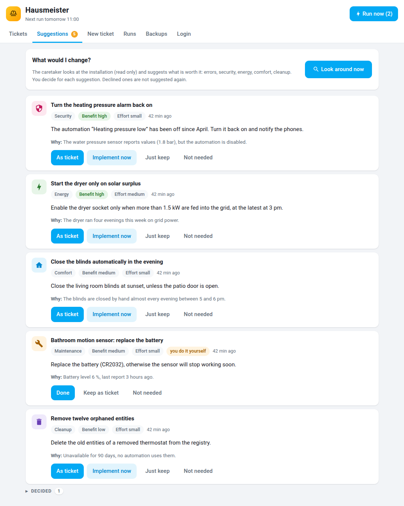
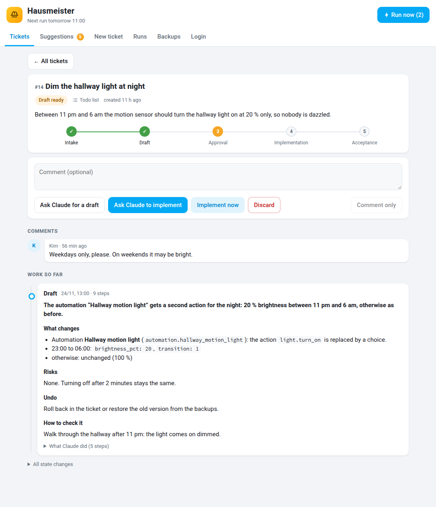
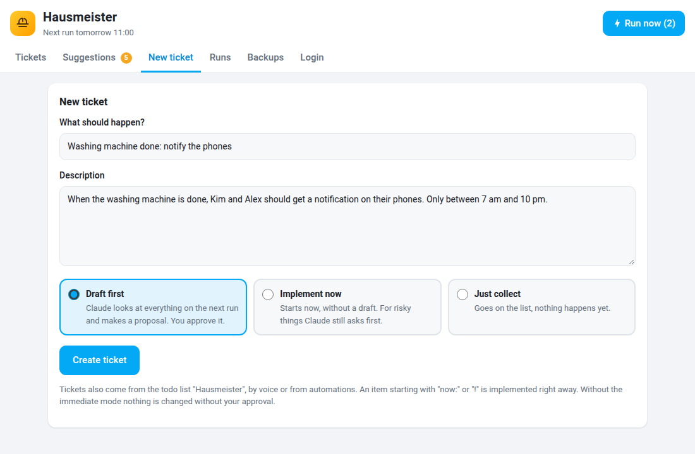

# Hausmeister

English | [Deutsch](README.de.md)

**Write down wishes and problems in your smart home, Claude Code takes care of them, you approve.**

Hausmeister ("caretaker") is a Home Assistant add-on with a small ticket board. Tickets come from a todo
list (also by voice), the board or an automation. At fixed times
[Claude Code](https://docs.claude.com/en/docs/claude-code/overview) looks at the installation, writes a
draft and implements it only after you approve it. A backup is made before, watches check afterwards
whether something broke, and one button rolls everything back.

Everything runs inside the add-on on your Home Assistant machine, including the login to Claude. No
other computer is needed.

The board, the notifications and Claude's texts are available in English and German. The language follows
Home Assistant or is set with the option `language`.


## What it does

- **Tickets from anywhere:** todo list "Hausmeister" (also through Assist), board in the sidebar, event
  `hausmeister_neues_ticket` from automations.
- **Draft first, then implementation:** in a draft Claude may only read. Nothing changes before "Ask Claude to implement".
- **Implement now** when it has to be quick: without approving a draft and without waiting for the schedule.
  For risky things Claude still asks.
- **Backup before every change:** snapshot of the configuration and a partial HA backup without the database.
- **Watches:** configuration check, shrunk or deleted files, vanished or unavailable entities, new errors in
  the log. Also between runs, when something else breaks something.
- **Roll back** with one button.
- **Push notifications with buttons:** approve, accept, ask for a fix or answer a question, right from the
  notification on your phone.
- **Live progress:** you see what Claude is doing right now.
- **Quota protection:** the add-on reads the usage of your Claude subscription and pauses scheduled runs
  above a limit, so enough is left for your other work.
- **"What would I change?":** the caretaker looks at your house and suggests what is worth it, with a reason,
  benefit and effort. You take a suggestion over as a ticket with one click or decline it. On demand or
  regularly as an inspection.
- **A document per ticket** as Markdown under `/share/hausmeister/tickets/`, plus a knowledge file about your house.

## How it looks

The screenshots show made-up example tickets.

**Suggestions:** what the caretaker would change in your house. Things a person has to do on site (battery,
device) are marked "you do it yourself".



| Draft to approve | New ticket |
| --- | --- |
|  |  |

**On the phone** (dark mode): overview with key figures and a question from Claude. You answer in the field
of the ticket or right from the push notification.

<p>

&nbsp;

</p>

## Requirements

- Home Assistant OS or Supervised (add-ons), amd64 or aarch64.
- A Claude subscription (Pro or Max) or an Anthropic API key. Each run uses quota.
  When nothing is queued, Claude is not started at all.

## Installation

1. In Home Assistant: **Settings → Add-ons → Add-on Store → ⋮ → Repositories**, add this address:
   `https://github.com/andreashergert1984/homeassistant-addons`
2. Install **Hausmeister**. The image is built on your machine, this takes a few minutes.
3. On the **Info** tab turn on "Show in sidebar" and start the add-on.
4. Optional: under **Settings → Devices & services → Add integration → Local To-do** create a list named
   **Hausmeister** (`todo.hausmeister`).

## Log in to Claude

1. Open **Hausmeister** in the sidebar, tab **Login**.
2. Type `claude` in the terminal, then `/login`.
3. Choose "Claude account with subscription", open the link in the browser, copy the code back into the terminal.
4. Quit with `/exit`. The board now shows that Claude is logged in.

The login stays in the add-on and is excluded from Home Assistant backups (those often end up in the
cloud). After restoring a backup you log in once more.

## Usage

**Create a ticket**, for example on the todo list "Hausmeister": "Only switch the hallway light on dimmed at night".
On the next run Claude writes a draft and you get a notification.

**Read the draft and decide:**

| Button | Effect |
| --- | --- |
| Ask Claude to implement | implemented on the next run |
| Implement now | implemented right away |
| Ask Claude for a draft | new draft, write your comment into the field first |
| Discard | close the ticket |

**After the implementation:** "Accept, all good", "Ask for a fix" with a comment, or "Roll back".

**Implement now from anywhere:** start a todo item with `now:`, `sofort:` or `!`, for example
"now: switch the Christmas lights on from 5 pm" (needs the option `allow_immediate_from_outside`,
otherwise the item gets a draft first).

**Ticket from an automation:**

```yaml
action: event.fire
data:
  event_type: hausmeister_neues_ticket
  event_data:
    titel: Humidity in the basement above 70 % for three days
    text: Please check whether the dehumidifier runs, and set up a warning.
    modus: entwurf   # entwurf (draft), sofort (now) or sammeln (collect)
```

**Get suggestions:** tab **Suggestions**, "Look around now". Or regularly with `inspection_day`.
For each suggestion: "As ticket" (draft), "Implement now", "Just keep" or "Not needed". Declined suggestions
do not come back.

**Sensors for dashboards:** `sensor.hausmeister_wartet_auf_dich` (tickets that need you) and
`sensor.hausmeister_offen` (all open ones, with next run, quota and current step).

## Options

| Option | Default | Meaning |
| --- | --- | --- |
| `run_times` | 11:00, 16:00 | times of the runs |
| `auto_draft` | on | draft new tickets right away |
| `max_tickets_per_run` | 5 | at most this many tickets per run |
| `run_timeout_minutes` | 30 | time limit per ticket |
| `backup_before_change` | on | partial HA backup before each implementation |
| `intake_todo` | todo.hausmeister | todo list for new tickets, empty turns it off |
| `notify_service` | | push service, e.g. `notify.mobile_app_my_phone` |
| `model` | | e.g. `sonnet` or `opus`, empty = Claude Code default |
| `max_quota_percent` | 80 | scheduled runs pause above this subscription usage, 0 = off |
| `max_backup_gb` | 2 | no HA backup before a change when the config folder is larger; the git snapshot still runs |
| `inspection_day` | off | inspection: `off`, `daily` or `mon` … `sun` (the German values `aus`, `taeglich`, `mo` … `so` still work) |
| `language` | auto | `auto` follows Home Assistant (English or German, otherwise English), `de` or `en` sets it |
| `allow_immediate_from_outside` | off | `sofort:`/`now:`/`!` in the todo list and `modus: sofort` in the event implement right away; off = a draft first |

## Safety, honestly

- Claude gets fixed rules: never rewrite a whole file, change `.storage` only through the API, do not switch
  devices, do not touch add-ons, updates, users or secrets, check the configuration before every restart. In a
  draft the writing tools are technically blocked.
- In the implementation the add-on has write access to the configuration and the Supervisor role `manager`.
  The rules are a strong guideline for the model, but not a sandbox. **Only approve drafts you understand.**
  This applies all the more to "Implement now".
- Board and terminal are only visible to Home Assistant admins and only answer the ingress of Home Assistant.
- Claude never gets the Supervisor token: its helpers go through a local proxy that only reads in a draft and
  never reaches the Supervisor API, `hassio.*`, `shell_command.*`, users or tokens. `secrets.yaml`, login files,
  the add-on itself and `curl`/`wget` are closed; web pages only from the Home Assistant docs and GitHub.
- From outside the board (todo list, events, notification buttons) only active admins count, at most 10 new
  tickets per hour, and immediate implementation needs `allow_immediate_from_outside`.
- In an implementation Claude still has a shell as the add-on user, so this is no sandbox.
- Backups: a git history of the configuration of its own (without databases, logs, login data, model folders
  and files over 20 MB) and, if turned on, a partial HA backup before every implementation.

Full documentation: [DOCS.md](DOCS.md). Changes: [CHANGELOG.md](CHANGELOG.md).
