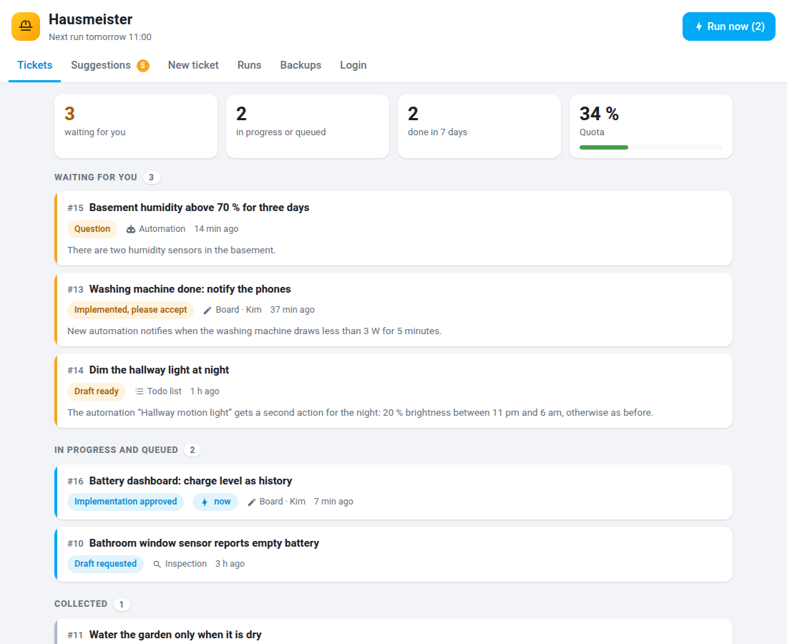
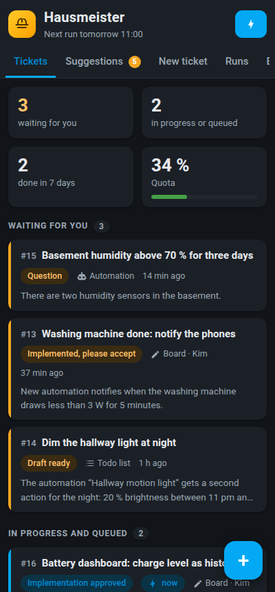
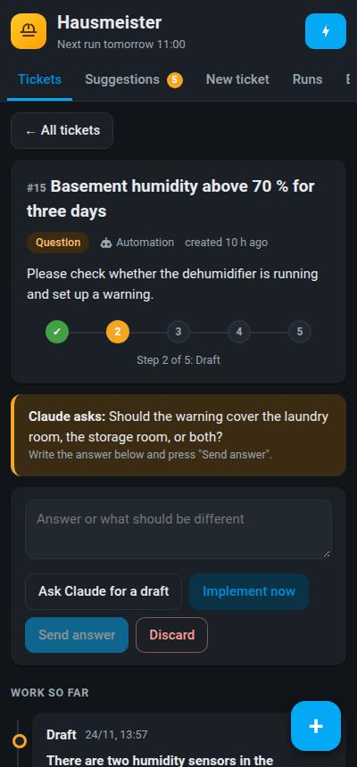

# Hausmeister

English | [Deutsch](README.de.md)

**Write down wishes and problems in your smart home, Claude Code takes care of them, you approve.**

Hausmeister ("caretaker") is a Home Assistant add-on with a small ticket board. Tickets come from a todo
list (also by voice), the board or an automation. At fixed times
[Claude Code](https://docs.claude.com/en/docs/claude-code/overview) looks at the installation, writes a
draft and implements it only after you approve it. A backup is made before, watches check afterwards
whether something broke, and one button sets the changed files back.

Everything runs inside the add-on on your Home Assistant machine, including the login to Claude. No
other computer is needed.

The board, the notifications and Claude's texts are available in English and German. The language follows
Home Assistant or is set with the option `language`.



## What it does

- **Tickets from anywhere:** todo list "Hausmeister" (also through Assist), board in the sidebar, event
  `hausmeister_neues_ticket` from automations.
- **Draft first, then implementation:** in a draft Claude may only read. Nothing changes before "Ask Claude to implement".
- **Implement now** when it has to be quick: without approving a draft and without waiting for the schedule.
  For risky things Claude still asks.
- **Backup before every change:** git snapshot of the configuration and, if turned on, a partial HA backup
  without the database.
- **Watches:** configuration check, shrunk or deleted files, vanished or unavailable entities, new errors in
  the log. Also between runs, when something else breaks something.
- **Roll back** the files of an implementation with one button.
- **Push notifications with buttons:** approve, accept, ask for a fix or answer a question, right from the
  notification on your phone.
- **Live progress:** you see what Claude is doing right now.
- **Quota protection:** the add-on reads the usage of your Claude subscription and pauses scheduled runs
  (and immediate tickets from outside the board) above a limit, so enough is left for your other work.
- **"What would I change?":** the caretaker looks at your house and suggests what is worth it, with a reason,
  benefit and effort. You take a suggestion over as a ticket with one click or decline it. On demand or
  regularly as an inspection.
- **A document per ticket** as Markdown under `/share/hausmeister/tickets/`, plus a knowledge file about your house.

## How it looks

The screenshots show made-up example tickets.

**Suggestions:** what the caretaker would change in your house. Things a person has to do on site (battery,
device) are marked "you do it yourself".


| Draft to approve | New ticket |
| --- | --- |
|  |  |

**On the phone** (dark mode): overview with key figures and a question from Claude. You answer in the field
of the ticket or right from the push notification.

<p>

&nbsp;

</p>

## Requirements

- Home Assistant OS or Supervised (add-ons), amd64 or aarch64.
- A Claude subscription (Pro or Max) or an Anthropic Console account (API billing, also chosen at `/login`).
  Each run uses quota.
  When nothing is queued, Claude is not started at all.

## Installation

1. In Home Assistant: **Settings → Add-ons → Add-on Store → ⋮ → Repositories**, add this address:
   `https://github.com/andreashergert1984/homeassistant-addons`
2. Install **Hausmeister**. The image is built on your machine, this takes a few minutes.
3. On the **Info** tab turn on "Show in sidebar" and start the add-on.
4. Optional: under **Settings → Devices & services → Add integration → Local To-do** create a list named
   **Hausmeister** (`todo.hausmeister`).

## Log in to Claude

1. Open **Hausmeister** in the sidebar, tab **Login**.
2. Type `claude` in the terminal, then `/login`.
3. Choose "Claude account with subscription", open the link in the browser, copy the code back into the terminal.
4. Quit with `/exit`. The board now shows that Claude is logged in.

The login stays in the add-on and is excluded from Home Assistant backups (those often end up in the
cloud). After restoring a backup you log in once more.

## Usage

**Create a ticket**, for example on the todo list "Hausmeister": "Only switch the hallway light on dimmed at night".
On the next run Claude writes a draft and you get a notification.

**Read the draft and decide:**

| Button | Effect |
| --- | --- |
| Ask Claude to implement | implemented on the next run |
| Implement now | implemented right away |
| Ask Claude for a draft | new draft, write your comment into the field first |
| Discard | close the ticket |

**After the implementation:** "Accept, all good", "Ask for a fix" with a comment, or "Roll back".

**Implement now from anywhere:** start a todo item with `now:`, `sofort:` or `!`, for example
"now: switch the Christmas lights on from 5 pm" (needs the option `allow_immediate_from_outside`,
otherwise the item gets a draft first).

**Ticket from an automation:**

```yaml
action: event.fire
data:
  event_type: hausmeister_neues_ticket
  event_data:
    titel: Humidity in the basement above 70 % for three days
    text: Please check whether the dehumidifier runs, and set up a warning.
    modus: entwurf   # entwurf (draft), sofort (now) or sammeln (collect)
```

**Get suggestions:** tab **Suggestions**, "Look around now". Or regularly with `inspection_day`.
For each suggestion: "As ticket" (draft), "Implement now", "Just keep" or "Not needed"; for things you do
yourself "Done", "Keep as ticket" or "Not needed". Declined suggestions do not come back ("Bring back"
restores one).

**Sensors for dashboards:** `sensor.hausmeister_wartet_auf_dich` (tickets that need you) and
`sensor.hausmeister_offen` (all open ones, with next run, quota and current step).

## Options

| Option | Default | Meaning |
| --- | --- | --- |
| `run_times` | 11:00, 16:00 | times of the runs |
| `auto_draft` | on | draft new tickets from the todo list and events without `modus`; off = only collect |
| `max_tickets_per_run` | 5 | at most this many tickets per run |
| `run_timeout_minutes` | 30 | time limit per ticket |
| `backup_before_change` | on | partial HA backup before each implementation |
| `intake_todo` | todo.hausmeister | todo list for new tickets, empty turns it off |
| `notify_service` | | push service, e.g. `notify.mobile_app_my_phone` |
| `model` | | e.g. `sonnet` or `opus`, empty = Claude Code default |
| `max_quota_percent` | 80 | scheduled runs and immediate tickets from outside the board pause above this subscription usage, 0 = off |
| `max_backup_gb` | 2 | no HA backup before a change when the config folder is larger; the git snapshot still runs |
| `inspection_day` | off | inspection: `off`, `daily` or `mon` … `sun` (the German values `aus`, `taeglich`, `mo` … `so` still work) |
| `language` | auto | `auto` follows Home Assistant (English or German, otherwise English), `de` or `en` sets it |
| `allow_immediate_from_outside` | off | `sofort:`/`now:`/`!` in the todo list and `modus: sofort` in the event implement right away; off = a draft first; the board and notification buttons are not affected |

## Security, honestly

What the add-on does to protect your installation:

- **Only through Home Assistant:** board, API and terminal answer only the ingress gateway of the
  Supervisor (checked by IP address) and loopback; other add-ons in the internal network get 403. The
  panel is only available to Home Assistant admins.
- **Drafts and inspections as a user of their own:** they run as the user `hausmeister` (uid 1001), not
  as root. That user cannot write the configuration and cannot read the add-on options, the ticket state
  or the snapshot repository. Its shell is restricted to `ha-read`, `cfg-git`, `echo`, `printf` and
  `date`; `ha-read` and `cfg-git` go through a local proxy in the add-on, and `ha-read` only reads (GET
  requests, a fixed list of WebSocket commands, templates, the configuration check, the Core log). Files
  are read only with Claude's Read, Grep and Glob tools; the writing tools are blocked.
- **Deny rules in every phase:** `secrets.yaml` (in every folder), `.storage/auth*`,
  `.storage/core.config_entries` and `.storage/*credential*` (for example `application_credentials`),
  the login of Claude, the snapshot repository, `/proc` and the add-on code are closed for reading and
  editing; `curl`, `wget` and `nc` are closed in the shell. `cfg-git` checks every argument (no options
  that write files or run programs), leaves these files out of every diff, log and listing and refuses
  them when they are named.
- **No Supervisor token for Claude:** neither Claude nor the terminal gets it. Each Claude call gets a
  token of its own for the proxy: read only in drafts and inspections; in an implementation it may also
  write, but never reaches the Supervisor API, the services `hassio.*`, `shell_command.*` and
  `homeassistant.stop`, users and logins, credentials of integrations, `execute_script` or the events
  of the add-on.
- **Internet:** web search, and WebFetch only for home-assistant.io, community.home-assistant.io,
  github.com and raw.githubusercontent.com.
- **From outside the board** (todo list, event `hausmeister_neues_ticket`, notification buttons): only
  active admins count, events of the add-on's own user are ignored. Each notification carries a random
  one-time code; a button works once and only on the latest notification of a ticket. At most 10 new
  tickets per hour. Immediate implementation from the todo list or an event only with the option
  `allow_immediate_from_outside`, otherwise the ticket gets a draft first.
- **Quota limit:** above `max_quota_percent` scheduled runs and immediate tickets from outside the board
  wait until the usage window resets.
- **Backup, watches, rollback:** before every implementation a git snapshot of the configuration (in
  `/data/configgit`, only root reads it, not part of HA backups) and, if turned on and the folder is not
  larger than `max_backup_gb`, a partial HA backup without the database. Afterwards the watches check the
  configuration, shrunk or deleted files and vanished or unavailable entities; "Roll back" sets the
  changed files back.
- **File rights:** the add-on does not change rights in the configuration folder of Home Assistant. (The
  only exception was a one-time repair in 0.8.2 that set `secrets.yaml` back to 0644 after 0.8.1 had made
  it 0600.)

What remains:

- **The implementation after your approval runs as root with a full shell.** It has to, to change
  `configuration.yaml` and the other files. Technically it can therefore reach everything in the
  container, including the Supervisor token (for example from the environment of the add-on process,
  with the role `manager`) and the network (for example with `python3` or `node` instead of `curl`).
  What protects you there is your approval of the draft, the rules for Claude, and the watches and
  rollback afterwards. **Only approve drafts you understand.** "Implement now" skips that approval, so
  use it only for small, clear tasks.
- **Prompt injection:** Claude reads texts from your installation (entity names, attributes, files, log
  lines, the knowledge file, comments). Such a text can contain instructions that steer Claude. A draft
  cannot change anything, but it can propose something harmful. Read drafts before you approve them.
- **The deny rules depend on Claude Code.** Home Assistant writes `secrets.yaml` and
  `.storage/core.config_entries` readable for all local users (0644), so the draft user could read them
  at file level; what keeps drafts away is the permission check of Claude Code and the restricted shell.
- **The terminal** in the board is a root shell for admins. It has no Supervisor token, but as root it
  could get it the same way as an implementation.
- **The snapshots contain `secrets.yaml`** and the credential stores of integrations, because a rollback
  needs them. They stay in `/data/configgit`, which is excluded from HA backups.

## Updating from a version before 0.8

- Buttons in notifications from before 0.8.0 no longer work (they carry no one-time code). Use the board
  or the buttons of the next notification.
- Todo items starting with `sofort:`, `now:` or `!` and `modus: sofort` in events now give a draft,
  unless you turn on the option `allow_immediate_from_outside`.
- The event `hausmeister_neues_ticket` only counts with the user of an active admin. Automations triggered
  by a sensor run without a user; let them add an item to the todo list instead (`todo.add_item` on
  `todo.hausmeister`).
- The knowledge file is now `/data/wissen.md` inside the add-on (edit it in the terminal of the board).
  An existing `/share/hausmeister/WISSEN.md` is taken over once; after that the file in `/share` is only
  an export that is overwritten on start and after every run.

Full documentation: [DOCS.md](DOCS.md). Changes: [CHANGELOG.md](CHANGELOG.md).
